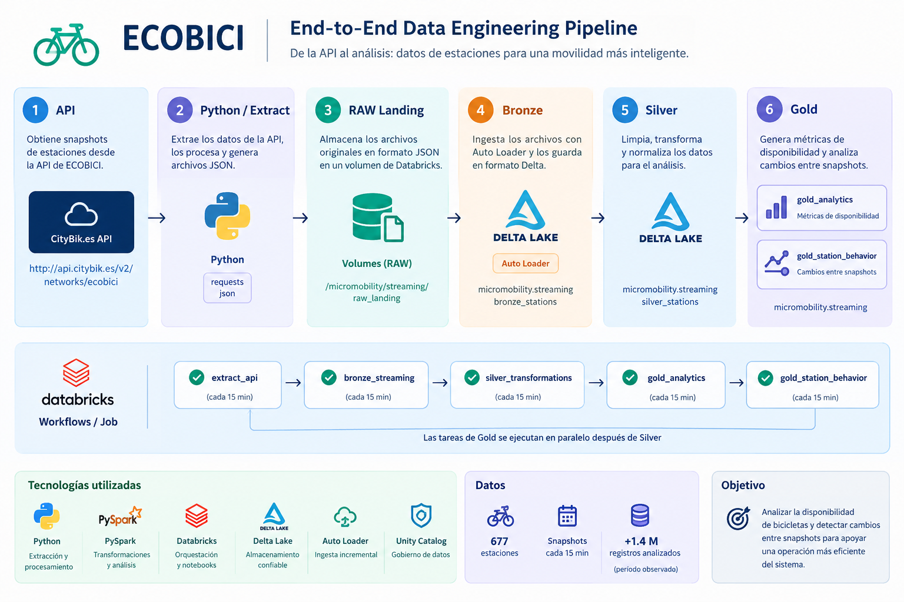

# ecobici-data-engineering-pipeline

End-to-end data engineering pipeline using Python, Databricks, PySpark, Auto Loader and Delta Lake to analyze ECOBICI station availability.

ECOBICI Data Engineering Pipeline

An end-to-end Data Engineering project built with Databricks, PySpark and Python, using real-time station data from the ECOBICI bike-sharing system in Buenos Aires.

Architecture

API → Raw → Bronze → Silver → Gold

The pipeline extracts station data from the CityBik.es API, stores JSON snapshots and processes them through the Medallion Architecture using Delta tables.

Technologies

Python

Databricks

Apache Spark / PySpark

Delta Lake

Auto Loader

REST API

Git / GitHub

Data Pipeline

Extraction: Retrieves station availability data from the ECOBICI API.

Bronze: Ingests raw JSON data using Databricks Auto Loader.

Silver: Cleans, transforms and structures station data.

Gold: Generates analytics on station occupancy, availability and bike movement patterns.

Data Quality: Includes validation checks to assess data consistency.

Key Features

Automated data ingestion and processing.

Incremental file ingestion with Auto Loader.

Medallion Architecture implementation.

Delta Lake tables for structured data storage.

Databricks Workflows for pipeline orchestration.

Data Source

CityBik.es API – ECOBICI Buenos Aires

Project developed as part of my Data Engineering portfolio.
