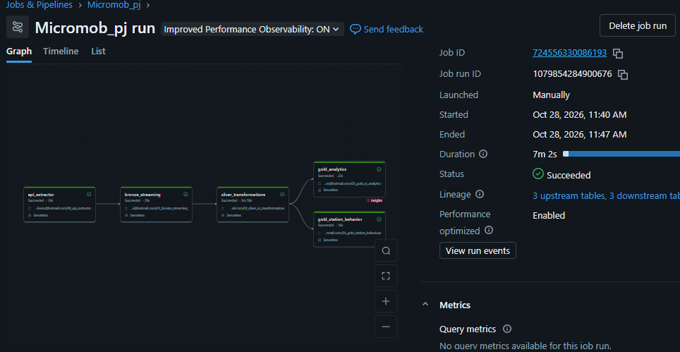

ECOBICI Data Engineering Pipeline

An end-to-end Data Engineering project built with Python, Databricks and PySpark, using station availability data from the ECOBICI bike-sharing system in Buenos Aires, Argentina.

Architecture

The pipeline follows the Medallion Architecture, processing data through Raw, Bronze, Silver and Gold layers.

Technologies

Python – API data extraction

Databricks – Data processing and orchestration

Apache Spark / PySpark – Distributed data transformations

Auto Loader – Incremental data ingestion

Delta Lake – Reliable data storage

REST API – Data source

Git / GitHub – Version control

Data Pipeline

Extraction: Retrieves station availability data from the CityBik.es ECOBICI API and stores JSON snapshots.

Bronze: Ingests raw JSON data using Databricks Auto Loader.

Silver: Cleans, transforms and structures station data.

Gold: Generates analytical datasets for station occupancy, availability and bike movement patterns.

Data Quality: Performs validation checks to assess data consistency.

Pipeline Execution

The pipeline is orchestrated using Databricks Workflows, with task dependencies between extraction, ingestion and transformation stages.

Key Features

Automated API data extraction.

Incremental ingestion with Auto Loader.

Medallion Architecture implementation.

Delta Lake tables for structured data storage.

Analytical transformations using PySpark.

Workflow orchestration with Databricks.

Data Source

CityBik.es API – ECOBICI Buenos Aires

Project developed as part of my Data Engineering portfolio.
